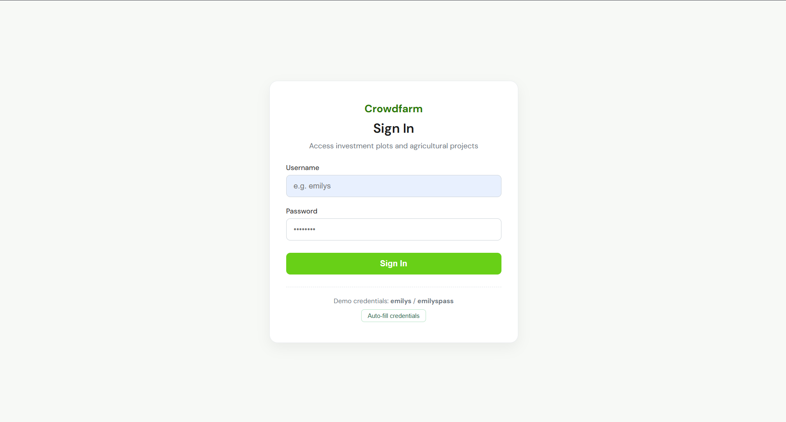
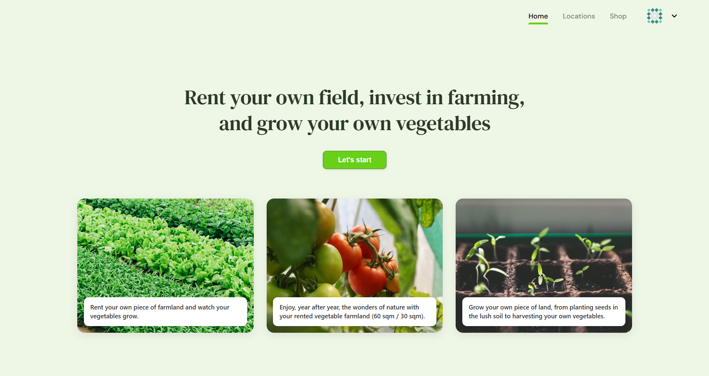
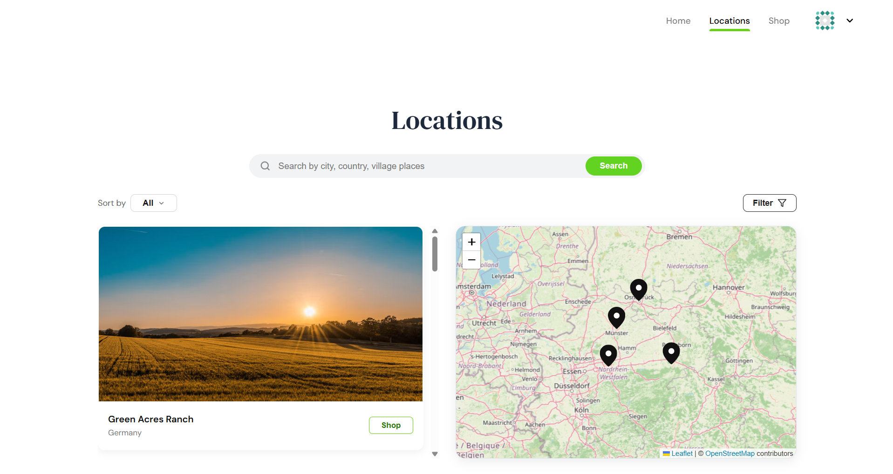
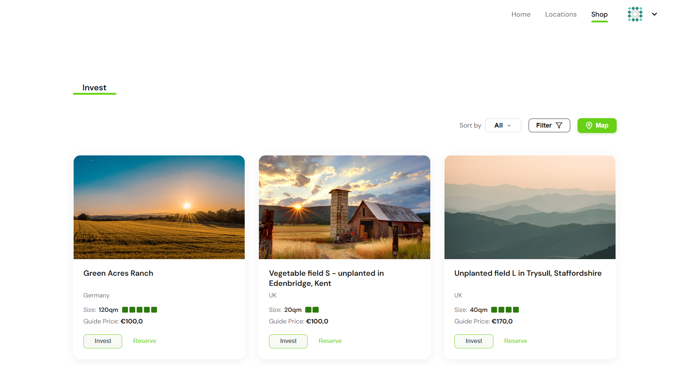

# Crowdfunding SPA

SPA for farmland and crowdfunding based on the Figma design. The platform allows users to explore available investment plots, search and filter listings and view opportunities on an interactive map.

## Tech Stack

- React 19
- Webpack 
- Babel 
- React Router 
- Redux Toolkit
- RTK Query
- DummyJSON API
- React Leaflet and Leaflet
- Native CSS with custom properties and responsive layout

## Getting Started

### Installation

Clone the repository and install project dependencies:

git clone (https://github.com/DaryaKarni/Crowdfunding-SPA.git)
cd Crowdfunding-SPA
npm install

### Development Mode

Start the local development server:

npm start

The project will be available at http://localhost:3000

### Production Build

Create an optimized production bundle in the dist directory:

npm run build

## Test Credentials

Authentication uses the DummyJSON Auth API. You can use the following test account:

- Username: emilys
- Password: emilyspass

Alternative valid DummyJSON account:

- Username: kminchelle
- Password: 0lelplR

## Routing Architecture

- /login - Public route containing authentication form, client validation, and error display. Authenticated users are redirected to the home page.
- / - Protected home screen with hero presentation, primary call to action, and featured projects.
- /locations - Protected screen combining searchable project list with an interactive map view.
- /shop - Protected catalogue screen displaying investment cards in a responsive grid.
- * - Fallback route redirecting unknown paths to the home view.

## Core Features and Implementation

### Webpack Configuration

The project uses a custom Webpack configuration without third-party boilerplates:

- JavaScript and JSX transpilation via babel-loader.
- Native stylesheet processing using style-loader and css-loader.
- Dynamic asset handling for images and icons.
- HtmlWebpackPlugin with template injection.
- Development server with historyApiFallback enabled to ensure client-side routing persistence.

### State Management and Data Fetching

- RTK Query serves as the single source for server-side state, handling caching, query lifecycle, loading states, and network errors.
- Client state such as current authentication tokens and user profiles is maintained in Redux Toolkit slices.
- The project adapts DummyJSON records to match the crowdfunding domain by adding real-world plot areas, agricultural naming conventions, and geographic coordinates.

### Interactive Map and Two-Way Synchronization

- The Locations screen renders project cards alongside Leaflet map markers.
- Selecting a card centers the map on the selected parcel and highlights its marker.
- Clicking any map marker selects the corresponding card in the side panel.
- Search queries, category filters, and price sorting apply concurrently to both cards and map markers.

### Application States

- Loading states display animated loaders or skeletons during data retrieval.
- Error states show descriptive API notifications with recovery options.
- Empty states notify users when active filter combinations yield no results.

### Session Persistence

Authentication status and basic profile data persist across browser refreshes through localStorage synchronization in the auth slice.